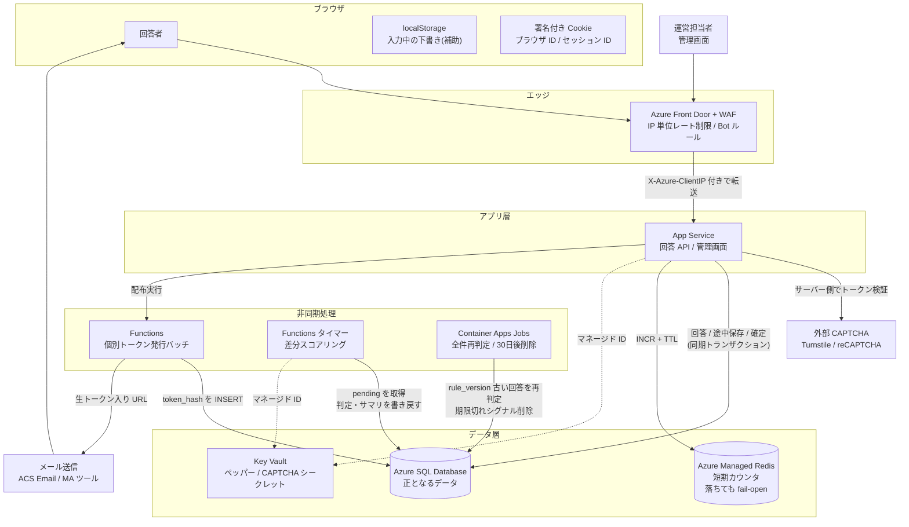
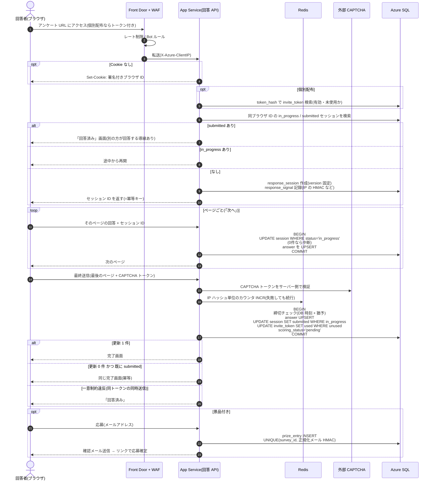
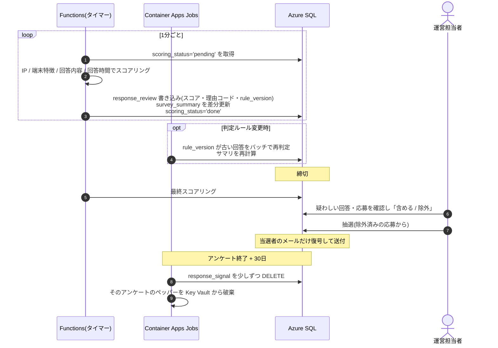
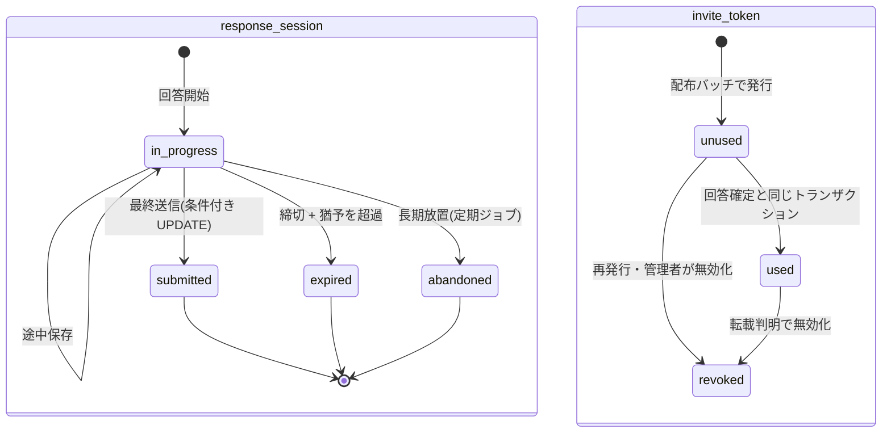

## 回答欄

### 1. 重複のパターン分類と方針

- 回答後即回答での回答（Queueにたまっている状態で即回答できてしまう）：受け付けるがフラグを付ける(ソフト)
- BOTによる大量回答
- セッション、キャッシュを削除した状態で再回答（シークレットモード等）
- 別個人情報等を用いた同一の人による回答

### 2. 識別シグナルの設計

- jwtトークンによる一意な識別？
  - スクリプト側でUUIDの発行→一意なトークン
    - いや、これはまったく意味ない
- セッションIDをリクエストに含めて送信
    - 同一セッションからの回答は除外できる
- 

### 3. RDB のデータモデルと一意性の保証
回答データ蓄積テーブル
- sessionIDカラムにUNIQUE制約
    - 同一セッションIDの回答は棄却
- メールアドレスにUNIQUE制約
    - 同一メールアドレスは棄却
        - 同一氏名別メアドははじけない前提

### 4. 回答のデータフロー

- BOT検証
↓
- リクエスト
↓
- ServiceBusへ送信
↓
- Reciever(QueueTriggerFunction)
↓                                   ↓
- Azure SQL ServerへINsert          仮回答RedisでSessionID, mailaddressをHSET
↓                                   ↓
    - UNIQUE制約で重複回答はじく      HGETしてfilter→重複がない場合カウント数のREDISへSET
↓
INSERTした回答を仮回答RedisへHSET

### 5. ボット・大量送信への対策と Azure サービスの選定
- robots.txtの配置（詳しくわかっていない）
- RateLimitの設置（詳しくはわかっていない）

### 6. 非同期の重複スコアリングと抽選前クレンジング
- ここもよくわかっていない

### 7. プライバシーとデータ保持
-  ソルトはAzureKeyVaultに入れるべき？（ハッシュ化アルゴリズムとソルトが判明した場合、盗聴により可逆変化可能？）

### 8. エッジケース

---

## 模範解答

### 全体像(先に結論)

- **確実に防げるのは「サーバーが発行した ID に RDB の一意制約を効かせられるもの」だけ**。具体的には次の 2 つ
  - 個別配布のトークン(1 トークン 1 完了回答)
  - 回答セッション ID(二重送信の冪等化)
- オープン配布での「同一人物の再回答」は、ログインがない以上**確率的にしか判定できない**。そこで次の 2 段構えにする
  - 送信時: 安く確実なものだけ同期的に止める(ボット・明らかな連投・同一ブラウザ)
  - 送信後: 非同期で「同一人物らしさ」をスコアリングし、**拒否ではなくフラグ**を付ける。抽選と集計の段階で除外する
- 景品の不正は「回答」ではなく「**応募**」の段階で、メール確認や SMS 認証などの強い本人性を使って抑える(回答の匿名性と回答率を保つため)

```
[ブラウザ]
   │ ① 初回アクセス: サーバーがブラウザ ID(署名付き Cookie)を発行
   ▼
[Front Door + WAF] ── IP 単位のレート制限、Bot ルール、明らかな攻撃を遮断
   │ X-Azure-ClientIP を付与して転送
   ▼
[App Service (回答 API)]
   │ ② 回答開始: 回答セッション ID を発行(=冪等キー)
   │ ③ 途中保存: セッションに紐づけて回答を UPSERT
   │ ④ 最終送信: CAPTCHA 検証 → 状態遷移 UPDATE + 一意制約で確定
   │    (同じトランザクションで「スコアリング待ち」を記録)
   ├──────────► [Redis] 短期カウンタ(IP ハッシュ単位の送信数など)。落ちても正しさは崩れない
   ▼
[Azure SQL Database] ← 正となるデータ(回答・トークン・シグナル・判定結果)
   ▲
   │ ⑤ 定期 / イベントで未判定の回答を取得
[Azure Functions (スコアリング)] ── 判定結果・集計サマリを書き戻す
   ▲
[Key Vault] ハッシュ用ペッパー、CAPTCHA のシークレット
```

### 全体図(Mermaid)

#### 構成図



#### 回答のシーケンス(開始 → 途中保存 → 最終送信 → 応募)



#### 非同期スコアリングと抽選



#### 回答セッション・個別トークンの状態遷移



---

### 1. 重複のパターン分類と方針

| # | パターン | オープン配布 | 個別配布 | 理由 |
|---|---|---|---|---|
| 1 | 送信ボタンの連打・通信リトライ・複数タブからの送信 | **ハード**(1 件として扱う。2 回目にもエラーではなく「完了」を返す) | 同左 | 本人の意図は 1 回答。冪等にすれば誤検知はゼロ |
| 2 | 同じトークンでの 2 回目の回答・同時送信 | ― | **ハード**(拒否) | トークンは 1 人 1 つで、確実に判定できる |
| 3 | 同じブラウザ(Cookie が残っている)での再回答 | **画面上はハード**(「回答済み」と表示)。ただし「別の人として回答」の導線は残し、その場合はソフト | トークンで判定するので不要 | 家族の端末共有など正規の理由がある。DB の一意制約にはしない |
| 4 | Cookie の削除・シークレットモード・別ブラウザでの再回答 | **ソフト** | トークンで判定するので不要 | ブラウザ ID が変わるため、IP や端末特徴などの弱い手がかりでしか結びつけられない |
| 5 | 同じ IP からの複数回答 | **許容**(件数が異常なときだけソフト) | 許容 | 学内 Wi-Fi・社内 NAT・CGNAT で正規回答者が大量に共有している |
| 6 | ボット・スクリプトによる大量送信 | **ハード**(WAF のレート制限、CAPTCHA) + ソフト(すり抜けた分) | ハード(トークンがなければ回答できない) | 機械的に止めても正規回答者への影響が小さい |
| 7 | 極端に短い回答時間・全問同じ選択肢 | **ソフト** | ソフト | 不正確な回答であって重複ではない。統計の品質のため除外候補にする |
| 8 | 個別 URL の転載(本人以外による回答) | ― | 先に完了した回答を有効にする。アクセス元の多さで**ソフト** | トークンの持ち主が誰かはサーバーにはわからない |
| 9 | 別のメールアドレスを使った、同一人物の複数応募(景品目的) | 応募段階で**正規化して一意制約**(ハード) + 回答側の手がかりで**ソフト** | 会員と紐づくので不要 | 景品の不正は「応募」の段階で止める |

**オープン配布と個別配布の違い**

- 個別配布はトークンという確実な識別子があるので、「1 人 1 回答」をハードに保証する
- オープン配布は識別子が全部弱いので、**偽陽性(正規回答者を弾く)を避ける側に倒し**、ソフトで後から除外する
  - 景品付きの場合: 抽選前のクレンジングで除外する
  - 統計目的の場合: 集計時の切り替えで除外する

> 下書きへのコメント: 「キューにたまっている間に再回答できてしまう」のは、**確定処理を非同期にしたことによる問題**です。確定(一意性の判定)は同期の DB トランザクションで行い、キューは確定後の「スコアリング」だけに使えば、この問題自体が起きません(→設問 3・6)。

---

### 2. 識別シグナルの設計

| シグナル | 強さ | 回避のしやすさ | 誤検知のリスク | 用途 |
|---|---|---|---|---|
| 個別トークン | **強い**(確実) | 回避できない(ただし転載はされうる) | ほぼない | ハード判定 |
| 回答セッション ID | 強い(1 回の回答の中では) | ― | ない | 冪等化・途中再開 |
| ブラウザ ID(Cookie) | 中 | Cookie 削除やシークレットモードで簡単に回避できる | 端末共有の家族 | 同じブラウザでの再回答の検知 |
| IP(ハッシュ化) | 弱い | VPN やモバイル回線の切り替えで回避できる | **高い**(NAT・CGNAT) | 異常な集中の検知、ほかの手がかりと組み合わせる |
| 端末の特徴(UA・画面サイズ・タイムゾーン・言語など) | 弱い | 偽装できる | 高い(同じ機種の iPhone はほぼ同じ値になる) | ほかの手がかりの補強だけに使う |
| CAPTCHA・ボット判定スコア | ボット対策としては中〜強 | CAPTCHA 代行業者で回避される | 低い〜中 | ボットの排除 |
| 回答時間・回答パターン | 弱い | ― | 中 | 品質面のフラグ |
| 応募用メール(確認済み) | 中 | 使い捨てメールで回避される | 低い | 応募の重複判定 |
| 電話番号(SMS 認証済み) | 強い | 回避しにくい | 低い | 高額景品の応募 |

**ブラウザ ID の保存方法**

- **どこに保存するか**
  - サーバーが `Set-Cookie` で発行する**ファーストパーティ Cookie**に保存する
  - 属性は `HttpOnly; Secure; SameSite=Lax`
  - JavaScript で書き込むストレージ(`document.cookie` や localStorage)は、Safari の ITP で**最大 7 日**に制限されるので、主な保存先にしない
- **どんな値を保存するか**
  - ランダムな ID にサーバーの署名(HMAC)を付けた値
  - 改ざんや偽造を検知できる。JWT でもよいが、中身は ID だけで十分
- **寿命**
  - アンケートの公開期間より長く設定する(例: 1 年)
  - ただし「消されるもの」として扱い、ハード判定の根拠にはしない
- **シークレットモード・トラッキング防止**
  - ウィンドウを閉じると消えるので、再回答されても**検知できない前提**で設計する
  - そのため、補完は非同期のスコアリングで行う

> 下書きへのコメント: 「スクリプト側で UUID を発行」すると、**クライアントが自由に値を選べてしまう**ので、識別子として信用できません(毎回新しい UUID を作れば別人になれる)。ID は**サーバーが発行して署名する**のが原則です。

---

### 3. RDB のデータモデルと一意性の保証

**主なテーブル**

| テーブル | 主な列 | 制約・ポイント |
|---|---|---|
| `survey` | id, 公開状態, 締切日時, 猶予時間 | |
| `survey_version` | id, survey_id, 版番号, 互換フラグ | 設問の変更は新しい版として追加し、上書きしない |
| `question` / `choice` | **固定の ID**, version_id, 文言 | 版をまたいでも ID を変えない(集計の軸になる) |
| `invite_token` | id, survey_id, **token_hash**, member_ref, 状態, 使用した回答 ID | `token_hash` は UNIQUE。トークンは生の値ではなくハッシュで保存する |
| `response_session` | **id(=冪等キー)**, survey_id, version_id, browser_id, invite_token_id, 状態, 開始・送信日時, スコアリング状態 | 下記の一意制約 |
| `answer` | session_id, question_id, 値 | UNIQUE(session_id, question_id)。途中保存は UPSERT |
| `response_signal` | session_id, ip_hmac, ip_prefix_hmac, fp_hmac, captcha_score, 回答所要秒, **削除予定日** | 30 日経過後に削除する対象 |
| `response_review` | session_id, スコア, 理由コード, **rule_version**, 人による判断(含める / 除外), 判断者 | 判定結果。回答そのものは変更しない |
| `prize_entry` | id, survey_id, session_id, **正規化メールの HMAC**, 暗号化したメール, 確認日時 | UNIQUE(survey_id, 正規化メールの HMAC) |
| `survey_summary` | survey_id, question_id, choice_id, 疑わしいフラグ, 件数 | 集計画面用のサマリ |

**回答セッションの状態遷移**

```
in_progress ──(最終送信)──► submitted
     │
     ├─(締切 + 猶予時間を過ぎた)─► expired
     └─(長期間放置)──────────► abandoned
```

**同じトークンでの同時送信を 1 件にする**

- `response_session` に**フィルター付き一意インデックス**を張る
  - 対象: `invite_token_id`
  - 条件: `WHERE status = 'submitted'`(Azure SQL / SQL Server で使える)
  - 同時に 2 つの送信が来ても、片方は一意制約違反になる
- あわせて `invite_token` 側も**条件付き UPDATE**で状態を変える
  - `UPDATE invite_token SET status='used' ... WHERE id=@id AND status='unused'`
  - 更新件数が 0 なら「すでに使用済み」と判断する
- **「SELECT で確認してから INSERT」は危ない**
  - Azure SQL は既定で RCSI(スナップショット読み取り)なので、2 つのトランザクションが両方とも「未使用」と読めてしまう
  - 最後のよりどころは必ず**一意制約か、条件付き UPDATE の更新件数**にする

**送信の二重実行を 1 件にする(冪等性)**

- 冪等キーは、**回答開始時にサーバーが発行する回答セッション ID**を使う
  - 別にリクエスト ID を作る必要はない
- 最終送信は、新しく INSERT するのではなく、**状態遷移の UPDATE**として行う
  - `UPDATE response_session SET status='submitted' ... WHERE id=@id AND status='in_progress'`
- 結果の扱い
  - 更新件数が 1: 今回の送信で確定した
  - 更新件数が 0 で、状態がすでに `submitted`: **同じ完了レスポンスを返す**(エラーにしない)
  - 更新件数が 0 で、状態が `expired` など: その状態に応じたエラーを返す
- 確定と同じトランザクションで、トークンを使用済みにし、スコアリング状態を `pending` にする。トランザクションの外で行うと、二重に書き込む問題が起きる

**ブラウザ ID は一意制約にしない**

- 端末を共有する家族のような正規のケースがある(設問 8a)ので、ソフト判定にとどめる

---

### 4. 回答のデータフロー

1. **URL にアクセス**
   - Front Door の WAF でレート制限と Bot ルールを適用する
   - App Service は Front Door からの通信だけを受け付ける(サービスタグ `AzureFrontDoor.Backend` と `X-Azure-FDID` ヘッダーで制限)
   - ブラウザ ID の Cookie がなければ発行する
   - 個別配布の場合は、トークンのハッシュで `invite_token` を検索し、有効かどうかを確認する
2. **回答開始**
   - **同じブラウザ ID・同じアンケートで `in_progress` のセッションがあれば、それを再開する**
   - `submitted` のセッションがあれば「回答済み」画面を出す(「別の人として回答する」導線は残す)
   - どちらでもなければ `response_session` を作り、**セッション ID を発行**する(Cookie またはページ内に保持)
   - このとき**版(version_id)を固定**する
   - IP の HMAC などの手がかりを `response_signal` に記録する
3. **ページごとの途中保存**
   - `answer` に UPSERT する(セッション ID + 設問 ID で一意)
   - 何度保存しても結果は同じになる(冪等)
4. **最終送信**
   - 次の 3 つを検証する
     - CAPTCHA のトークン
     - 締切(DB のサーバー時刻で判定する)
     - 必須設問がすべて回答されているか
   - 確定トランザクションでは、次の 3 つをまとめて行う
     - セッションの状態を UPDATE する
     - トークンを使用済みにする
     - スコアリング状態を `pending` にする
   - Redis の短期カウンタを加算する。結果は記録用で、確定するかどうかの判断には使わない
5. **完了画面**
   - 景品付きの場合は、ここで応募フォーム(メールや SMS)に進ませる。応募は回答とは別のトランザクション・別のテーブルで扱う

**途中保存の回答は重複判定の対象にするか**

- **しない**。重複判定の対象は `submitted` だけにする
- 理由
  - 途中で離脱した回答はノイズが多い
  - 一意制約を `submitted` に限定しているので、途中のセッションが複数あっても問題がない
- 放置されたセッションは、定期的に `abandoned` にして集計からも外す

---

### 5. ボット・大量送信への対策と Azure サービスの選定

**層ごとの役割**

| 層 | 対策 | 目的 |
|---|---|---|
| エッジ | Front Door WAF(マネージドルール、Bot Manager ルール、**IP 単位のカスタムレート制限**) | 大量のリクエストをオリジンに届く前に落とす |
| アプリ | CAPTCHA、hidden の囮項目(honeypot)、最短の回答時間チェック | すり抜けたボットを送信時に止める |
| 短期カウンタ | Redis で IP ハッシュ単位の送信数を数え、しきい値を超えたら CAPTCHA を必須にする | 段階的に締める。いきなりブロックしない |
| 非同期 | スコアリング | すり抜けた分を後からフラグにする |

**エッジの WAF: Front Door WAF を採用する**

| | Front Door WAF(採用) | Application Gateway WAF |
|---|---|---|
| 配置 | **グローバルなエッジ**(世界中の拠点) | リージョン内(VNet の中) |
| 遮断する場所 | オリジンに届く前に、エッジで落とす | リージョンに到達してから落とす |
| 向いている用途 | インターネットに公開するサイト、CDN 併用、マルチリージョン | VNet 内のバックエンド、閉域構成、L7 の細かいルーティング |
| レート制限 | IP 単位のカスタムルールがある(エッジ拠点ごとに数えるので**厳密な値ではない**) | IP 単位のカスタムルールがある |

- 採用理由
  - 一般公開のアンケートで、SNS 経由でアクセスが急増するため、**エッジで吸収できる** Front Door が適している
  - すでに入口として Front Door を使っているので、二重に配置する必要がない
- Application Gateway を追加するのは、閉域の要件などがある場合だけにする
- レート制限のしきい値は**緩めに**設定する(例: 1 IP あたり毎分数百リクエスト)
  - 共有 IP の正規回答者を巻き込まないため
  - 細かい判定はアプリ側や非同期処理に任せる

**短期カウンタ: RDB か Redis か**

| | Azure SQL で数える | Redis(Azure Managed Redis / Azure Cache for Redis) |
|---|---|---|
| 仕組み | カウンタ行を UPDATE する | `INCR` + `EXPIRE` で数える |
| ホットな値の扱い | 大学の IP など**1 行に更新が集中してロック競合**が起きる | インメモリの単一スレッド処理なので競合しない |
| TTL | 削除ジョブが必要 | 自動で消える |
| 耐久性 | 高い | 揮発する(この用途なら問題ない) |

- 採用理由
  - 短期カウンタは**消えても困らない・書き込みが多い・期限付き**という性質なので、Redis が適している
  - 一方で、**一意性などの正しさは Redis に置かず、必ず SQL に置く**。Redis が落ちたときは、判定を飛ばして送信を通す(fail-open。→設問 8g)
- 規模について
  - ピークの 3,000 件/分は約 50 件/秒で、途中保存を含めても SQL で十分さばける
  - Redis は**必須ではなく、段階的に CAPTCHA を出すための補助**として位置づける

**人間であることの確認(CAPTCHA)**

- Azure には CAPTCHA のサービス自体がないので、外部サービス(Cloudflare Turnstile、reCAPTCHA、hCaptcha など)を使う
- 連携方法
  - ブラウザで取得したトークンを、**App Service から外部サービスの検証 API に送ってサーバー側で検証**する
  - クライアント側の結果だけを信用しない
  - 検証用のシークレットは Key Vault に置き、マネージド ID で参照する
- 要求するタイミング
  - **最終送信の時だけ**にする(各ページで求めると離脱が増える)
  - 景品付きのアンケート、またはカウンタがしきい値を超えた時だけ、見える形のチャレンジを出す
  - それ以外は、ユーザー操作が要らない方式(Turnstile の非表示モードやスコア型)にする
- Front Door WAF の JavaScript チャレンジ機能も選択肢になる。ただし提供状況を確認したうえで使う

---

### 6. 非同期の重複スコアリングと抽選前クレンジング

**疎結合の方法: SQL の状態列を使い、Functions で処理する**

- 最終送信のトランザクションで `scoring_status='pending'` を立てる(**Outbox パターンの簡易版**)
- Azure Functions の定期実行(例: 1 分ごと)で `pending` の回答を取得し、判定して書き戻す
- この方法の利点
  - 確定とイベント発行が**同じトランザクション**で行われるので、二重書き込みの問題(DB は成功したがキューへの送信は失敗した、など)が起きない
  - ピーク時は `pending` がたまるだけで、送信のレイテンシには影響しない
  - 判定は数分遅れても問題ない(抽選は締切の後に行う)

| 選択肢 | 特徴 | 今回の判断 |
|---|---|---|
| SQL の状態列 + 定期ポーリング | 追加サービスがない。トランザクションで整合性が取れる | **採用**。秒単位の即時性が不要なため |
| Service Bus | DLQ、重複検知、セッション(順序)、トランザクションがある。業務メッセージ向け | 即時判定が必要になったら、Outbox 経由で採用する |
| Storage Queue | 安くてシンプル。DLQ がなく、メッセージは最大 64KB | 小規模ならこれでもよい。機能の差で Service Bus を優先する |
| Event Grid | 「何かが起きた」通知を複数の購読者に配るためのもの | 作業キューではないので不向き |

| 実行基盤 | 特徴 | 今回の判断 |
|---|---|---|
| Azure Functions | タイマー・キューなどのトリガーで動く。従量課金で自動スケールする | **日々の差分判定に採用** |
| WebJobs | App Service と同じプランで動く | 回答 API と CPU やメモリを取り合うので避ける |
| Container Apps Jobs | 長時間のバッチや、手動・スケジュールでの一括実行に向く | **ルール変更後の全件再判定に採用** |

**判定ロジック(例)**

- 同じ `ip_hmac` + 同じ `fp_hmac` から、短い時間(例: 30 分)の間に複数回答がある
- ブラウザ ID は違うが、IP・端末の特徴・回答内容がほぼ一致する
- 回答所要時間が極端に短い、全問同じ選択肢を選んでいる
- 同じトークンへのアクセス元(IP)が多い(転載の疑い)

各ルールに重みを付けてスコアにし、**理由コード**と一緒に `response_review` に保存する。

**集計画面の「全件 / 疑わしい回答を除外」**

- `survey_summary` に**疑わしいフラグ別の件数**を持たせる
  - 全件の件数 = 両方のフラグの合計
  - 除外後の件数 = 疑わしくない側の件数
- スコアリングのジョブが、判定と同じタイミングでサマリを差分更新する
- 30 万件 × 50 問をその都度 JOIN して集計すると重いので、サマリを使う
- 担当者が手動で「含める / 除外」と判断した場合は、それを自動判定より優先する

**ルールを変更した後の再判定**

- 判定には `rule_version` を記録しておく
- ルールを変えたら、Container Apps Jobs で `rule_version` が古い回答を**バッチ単位で再判定**する。べき等に上書きし、サマリは再計算する
- 回答は「拒否」せずに保存してあるので、**過去の回答も救済したり除外し直したりできる**(フラグ方式の利点)
- ただし手がかり(シグナル)は 30 日で消えるので、**再判定できるのは保持期間内だけ**。期限を過ぎた回答は最後の判定結果を確定値として扱う

**抽選前のクレンジング**

1. 締切を過ぎたら最終スコアリングを実行する
2. 担当者が疑わしい回答・応募を確認し、「含める / 除外」を決める
3. 応募をまとめる: 正規化したメールで一意(登録時に保証済み)にし、さらに回答側のフラグがある応募を除く
4. 抽選する。当選者を確定した時だけ、応募情報(暗号化されたメール)を復号する

---

### 7. プライバシーとデータ保持

**単純なハッシュの問題**

- IPv4 は約 43 億通りしかないので、`SHA-256(IP)` は**全通りを計算すれば元に戻せる**。実質的に生の IP を保存しているのと同じになる
- **対策: 秘密の鍵(ペッパー)を使った HMAC にする**
  - 例: `HMAC(ペッパー, アンケートID + IP)`
  - 鍵を持っていない人には元に戻せない

**ペッパーの範囲**

- **アンケートごと**に分けて、アンケートをまたいだ突き合わせをできないようにする
  - 匿名性を保つため、目的外の追跡を防ぐ
  - アンケート ID を HMAC の入力に含めれば、ペッパー自体は共通でもよい
- 期間で区切る(ペッパーのローテーション)と同じ期間内でしか照合できなくなるので、**アンケートの公開期間中は固定**し、保持期間が終わったら破棄する
- IP は完全一致に加えて、**プレフィックス単位のハッシュ**も保持すると、近い IP からの集中を検知できる
  - IPv4 は /24、IPv6 は /64 で切る。IPv6 はアドレスが変わりやすいので、/64 単位で比べるのが実用的

**30 日後の削除**

- `response_signal` に削除予定日(アンケート終了日 + 30 日)を持たせ、定期ジョブで**少しずつ DELETE** する(大量に一度に消すとロックやログが増えすぎる)
- あわせて、そのアンケートの**ペッパーを破棄する**(暗号学的消去)
  - 万一バックアップやログにハッシュ値が残っていても、二度と照合できなくなる
  - Azure SQL の自動バックアップ(PITR)は保持期間を過ぎるまで残るので、この方法が効く
- 判定結果(`response_review` のスコアや理由コード)は匿名情報なので、回答と一緒に残してよい

**シークレット管理: Key Vault を採用する**

| | Key Vault(採用) | App Service のアプリ設定 | App Configuration |
|---|---|---|---|
| 用途 | シークレット・鍵・証明書 | 環境変数 | 機能フラグや設定値 |
| アクセス制御・監査 | RBAC、アクセスログ、論理削除・消去保護 | プランの権限を持つ人なら見える | シークレットの保管は Key Vault に任せる設計 |
| ローテーション | バージョン管理ができる | 手動で書き換える | ― |

- App Service や Functions からは**マネージド ID**で参照する(Key Vault 参照)
- 判定ルールのしきい値など、秘密ではない設定は App Configuration に置いてもよい

---

### 8. エッジケース

**a. 家族で 1 台のタブレットを共有し、2 人が回答したい**
- 画面には「この端末ではすでに回答済みです」と表示しつつ、「**別の方が回答する**」ボタンを用意する
- ボタンから新しいセッションを作るが、**同じブラウザ ID からの 2 件目としてソフトフラグ**を付ける
- 統計上は残す。景品の応募はメールや SMS で別々に確認するので、不正があっても応募の段階で抑えられる
- 同じブラウザから 3 件、4 件と続く場合はスコアを上げる

**b. 個別 URL が SNS に転載され、本人以外が先に回答した**
- 先に完了した回答が有効になり、本人は「回答済み」と表示される(システムは正しく動いている)
- 被害を抑える工夫
  - **景品はトークンに紐づく会員のメールアドレスに送る**ので、転載先の人が回答しても得をしない
  - 1 つのトークンへのアクセス元が多いとソフトフラグを付け、担当者が回答を無効にしてトークンを再発行できるようにする
  - 完了画面に「心当たりがない場合のお問い合わせ先」を出す

**c. 回答の途中で締切を過ぎた**
- 締切の判定は**DB サーバーの時刻**で行う(クライアントの時刻は信用しない)
- 「**締切前に開始したセッションは、締切後も猶予時間(例: 15 分)以内なら受け付ける**」というルールにする
- 開始が締切後なら回答を開始させない
- 猶予時間を過ぎてから届いた送信は `expired` として拒否し、画面で丁寧に説明する

**d. DB への書き込みは成功したのに、レスポンスが届かずユーザーが再送信した**
- 同じセッション ID での再送信になるので、状態遷移の UPDATE は更新件数 0 になる
- 状態が `submitted` なら、**1 回目と同じ完了レスポンスを返す**(冪等性)
- ユーザーには普通に完了画面が見え、回答は 1 件のまま
- 別のタブで新しいセッションを始めていた場合も、同じブラウザ ID なので「回答済み」の画面に誘導できる

**e. 公開中に設問が修正され、古い版で途中保存していた人が再開した**
- 設問と選択肢の **ID を固定**し、文言の修正や選択肢の追加は「**互換性のある新しい版**」として追加する
- 再開した時は最新の版を表示し、途中まで保存された回答は設問 ID で引き継ぐ
- 集計は設問 ID・選択肢 ID 単位で行うので、版をまたいでも合算できる
- 設問の削除や意味の変更のように**互換性のない変更は、公開中は禁止**する(または新しいアンケートとして扱う)
- 互換性のない版に切り替えた場合、古い版の途中回答は破棄されることを再開時に説明する

**f. 同じ大学キャンパスの IP から、授業中の 10 分間に 200 件の回答が届いた**
- **IP だけではブロックもフラグもしない**
  - WAF のしきい値は緩めにしているので通る
  - Redis のカウンタがしきい値を超えると CAPTCHA が必須になるが、人間なら突破できる
- スコアリングでは「IP は同じだが、ブラウザ ID・端末の特徴・回答内容がばらばら」なので、**正規の集中**と判断し、スコアを上げない
- 逆に「IP・端末の特徴・回答内容がそろっている」グループだけをフラグにする
- 授業などで配布することが事前にわかっている場合は、配布元のパラメータ付き URL(例: `?src=lecture-a`)を発行し、その経路では判定を緩める運用もできる

**g. 判定用の Redis が一時的に止まった**
- **送信は通す(fail-open)**
- 理由
  - Redis が担っているのは「段階的に CAPTCHA を出す」ことと「短期カウンタ」だけで、**一意性や冪等性は SQL が保証している**ので、正しさは崩れない
  - Redis が止まったことで回答を拒否すると、正規回答者を大量に失う(キャンペーンのピーク中なら損失が大きい)
- 補う方法
  - Redis が止まっている間は、**CAPTCHA を全員に必須**にする(安全側に切り替える)
  - 該当する回答に「Redis 判定なし」の印を付け、非同期のスコアリングで手厚く判定する
  - Front Door WAF のレート制限は Redis と無関係に効き続ける
