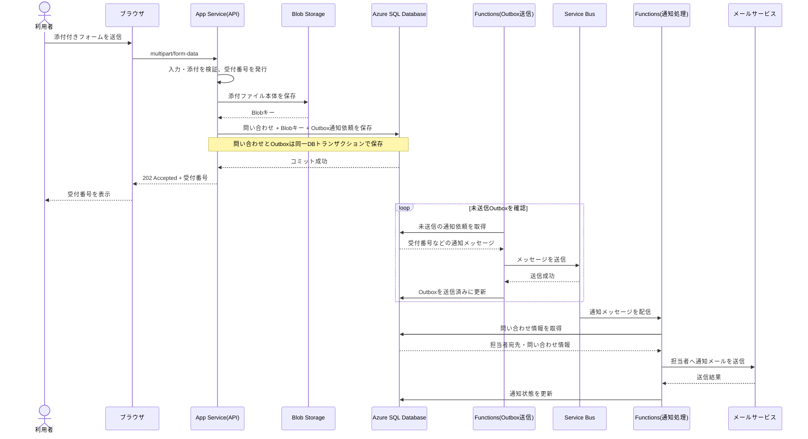
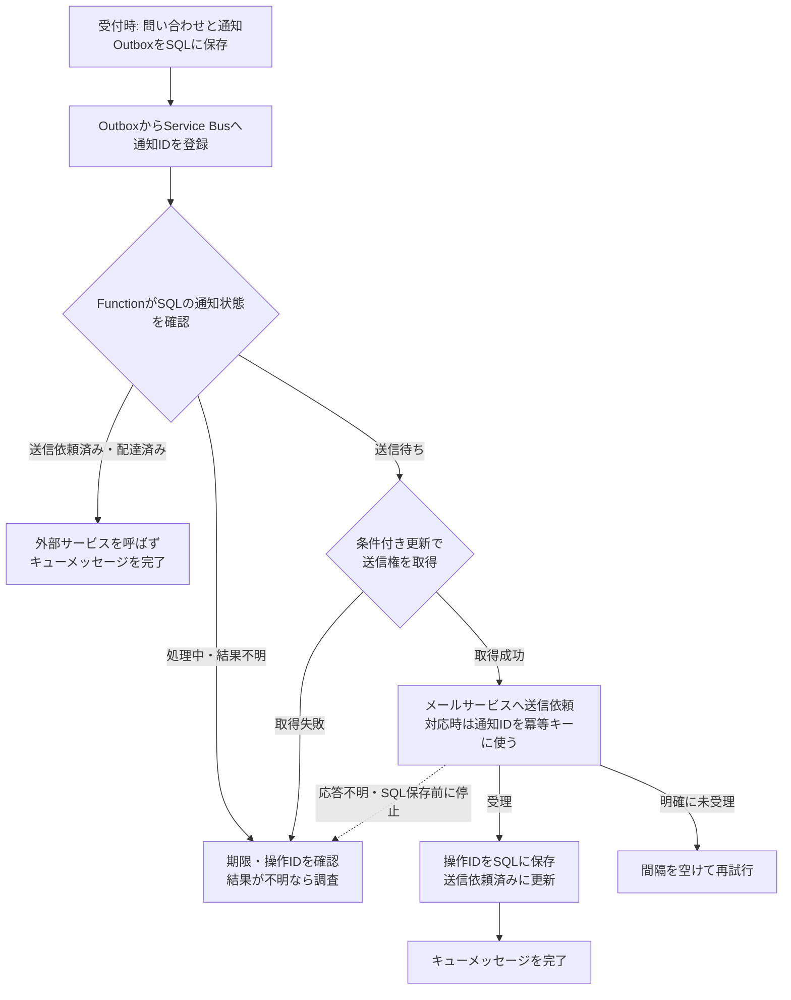

# 回答: 添付付き問い合わせの受付（初級）

- 問題: [QUESTION.md](QUESTION.md)
- 状態: 回答・レビュー済み

## 設問1: 受付から通知までの流れ

### 自分の回答

1. FormDataで送信
2. FrontDoor,WAF(BOTはじく)
2. AppService(`POST ~/api/v1/contact`等)
3. ServiceBusに入れる（成功時レスポンス200、永続層を前に先に返す）
4. Function
5. 回答：Azure SQL DataBase
- 氏名,連絡先、本文,ハッシュ化したファイル名,受付番号、状態、作成日時
6. データ：Blob(ハッシュ化)
7. 完了メール送信

### 振り返り

- `FormData` で送る点、App Service・Service Bus・Functions を使う方向はよい。
- **SQLやBlobに永続化する前にキューへ入れて応答する順序は避ける。** 受付記録や添付が保存される前に受付済みと返すと、後続処理の失敗でデータが残らない可能性がある。
- 受付番号を発行し、本文・添付を永続化してから受付成功を返す。メール通知はその後に非同期で進める。DB保存とキュー登録を確実に両立させるにはTransactional Outboxが候補。
- Functionの役割はService Busのメッセージを受けて担当者へ通知すること。問い合わせの正本はSQLに置く。
- ファイル本体はBlobにそのまま保存する。「ハッシュ化したファイル名」だけをBlobに置くのではない。SQLにはBlobのキー、元のファイル名、サイズ、Content-Typeなどを保存する。ハッシュ値は整合性確認などに必要な場合だけ別途保存する。
- 「完了メール」は設問の担当者向け通知を指すことを明記する。利用者には受付番号をAPIの応答で返す。

#### 改善例

1. ブラウザが `multipart/form-data` でApp Serviceへ送る。
2. App Serviceが入力・添付を検証し、受付番号を発行する。
3. 添付をBlobへ、問い合わせと添付メタデータをSQLへ保存する。
4. 通知依頼をService Busへ登録し、利用者へ受付番号を返す。
5. Service BusをトリガーにFunctionsが担当者へメールを送り、SQLの通知状態を更新する。

※ DB保存とキュー登録の間の障害でも通知依頼を失わないようにするなら、Outboxなどを追加する。

#### 模範解答の構成（Mermaid）

- 利用者への応答は、添付と問い合わせ、およびOutboxの保存が成功した後に返す。メール送信完了は待たず、受付番号を `202 Accepted` で返す。
- Outbox送信Functionは、DBへの受付記録とキュー登録の間で通知依頼が失われるのを防ぐための補助。通知本体のFunctionはService Bus Triggerで動く。再試行できると分かっている失敗は再試行とDLQで扱い、外部メールサービスが依頼を受理したか不明な場合は下記の手順で確認する。
- Outbox送信Function自体はTimer Triggerで定期確認する構成が簡単。より細かな即時性が必要なら、変更通知や別の起動方式も選べる。

## 設問2: 問い合わせと添付ファイルの保存先

### 自分の回答
- RDB：回答データ
- NoSQL：今回の検索だと大変？→使わない
- Blob Storage：容量が大きいデータはDBから参照する形で切り離す

### 振り返り

- RDBを受付記録、Blobをファイル本体にする判断は今回の検索条件とデータの性質に合っている。NoSQLを使わない判断も妥当。
- SQLにはBlobのURLそのものより、ストレージ内のキー（Blob名）を保存する。アクセスURLは必要時に発行できる。
- 比較では、RDBは受付番号・状態・作成日時で検索しやすく整合性も扱いやすい、NoSQLは柔軟な大量データやスケールが必要な場合に候補、Blobは大きなバイナリの保管向き、と整理すると理由が明確になる。

## 設問3: メール通知の非同期処理

### 自分の回答
Functionsでtimer-triggerで定期実行するのが一番よさそう？
状態を見て送るものを決めたいが、CQRSを考えると状態だけNoSQLに置いたほうがよさそう

### 振り返り

- Timer Triggerで定期的にSQLを走査する設計も可能だが、この要件ではService Busを使うので、**Service Bus TriggerのFunction**でメッセージ到着時に処理するのが自然。
- Service Busのメッセージには受付番号（または問い合わせID）を入れ、FunctionがSQLから担当者の宛先や本文を取得する。添付ファイル本体や個人情報をキューに複製しない。
- 通知状態に更新も参照も集中するなら、読み書きの負荷や求める鮮度を分けて考えるのはCQRSの観点として妥当。ただし、状態を別テーブルやNoSQLに移すこと自体がCQRSではない。今回の規模ならまずSQLを正本にし、必要な場合は通知状態を別テーブルにして索引や更新範囲を調整する。読み取りを独立に最適化する必要が出たら参照用モデルを追加する。

## 設問4: 通知失敗時の扱いと確認方法

### 自分の回答
- 再試行はtimer triggerが状態が変わっていないIDに対してリトライするので大丈夫（だが誤ったメアド書いている場合、DLQ に入れたい？）

### 振り返り

- 受理されていないことが分かる一時的な失敗は再試行し、上限を超えたメッセージはDLQへ移す。DLQの件数を監視し、運用担当者が原因を確認して修正後に再送できるようにする。
- SQLには `送信待ち / 処理中 / 送信依頼済み / 配達済み / 配達失敗 / 結果不明` などの状態と、必要に応じて試行回数・最終エラーを記録する。送信APIの成功と配達の成功を区別する。
- 誤ったメールアドレスなど再試行しても直らない恒久エラーは、DLQや失敗状態で確認できるようにする。宛先を修正して再送する運用を決める。
- Functionは同じキューのメッセージを再度受け取る可能性がある。送信依頼済みなら重ねて送らないよう、通知IDと状態を使って冪等に処理する。ただし外部サービスの受理直後に停止した場合の限界は、下記で扱う。

## 設問5: 二重送信の防止

### 自分の回答
メールアドレスのUNIQUE制約を作る、これで防げます

### 振り返り

- メールアドレスのUNIQUE制約では防げない。同じ利用者が別件の問い合わせを送ることもあるため、メールアドレスは一意にすべきではない。
- 送信フォームごとに冪等キー（UUIDなど）を発行し、再送時も同じキーを使う。SQLでそのキーに一意制約を付け、同じキーの再送には既存の受付番号を返す。
- 連打時のボタン無効化は補助になるが、通信再試行や同時リクエストにも対応できるサーバー側の一意制約が要点。

## 模範解答の深掘り

### 冪等性: メールを極力1件にするには

ここでは「1件の問い合わせに対する、担当者への通知」を1つの論理的な送信として扱う。フォームの二重送信を防ぐ冪等キー（設問5）と、**通知処理の重複を防ぐキー**は役割が異なる。後者は、例えば `問い合わせID + 通知種別 + 宛先` とし、SQLで一意にする。宛先変更後の再送を別の通知として扱うなら、その方針に合わせて通知IDを発行する。

1. 受付時に問い合わせと通知依頼（Outbox）を同一SQLトランザクションで保存する。OutboxからService Busへ再送する場合も、同じ通知IDをメッセージIDに使う。Service Busの重複検出を有効にすれば設定した期間内の重複投入を減らせるが、受信側の再配信は別途起こる。[Service Busの重複検出](https://learn.microsoft.com/en-us/azure/service-bus-messaging/duplicate-detection)
2. 通知FunctionはSQLの通知行を確認し、`送信待ち` から `処理中` への条件付き更新などで送信権を1つの実行だけが取得する。`送信依頼済み` や `配達済み` なら外部サービスを呼ばずにキューメッセージを完了する。処理中のまま止まる場合に備え、期限と調査・再開手順も持つ。Service Busは同じメッセージを再配信し得る。[Service Busの配信とロック](https://learn.microsoft.com/en-us/azure/service-bus-messaging/service-bus-message-loss-and-duplicates)
3. メールサービスに送信依頼が受理されたら、返された操作ID・メッセージIDをSQLに保存して `送信依頼済み` にし、その後キューメッセージを完了する。配達確認を要件に含める場合は、配達結果を受けて `配達済み` または `配達失敗` に進める。外部サービスの「送信成功」は受信者への到達を意味するとは限らない。例えばAzure Communication Services Emailの送信操作 `Succeeded` は配達に向けて送り出された状態で、詳細な配達結果は別のイベントで確認する。[Azure Communication Services Emailの送信状態](https://learn.microsoft.com/en-us/azure/communication-services/quickstarts/email/send-email)

**限界:** メールサービスが依頼を受理した直後、SQLへの結果保存前にFunctionが停止すると、再実行時には「受理されたか」が分からない。SQLの状態確認やService Busの重複検出だけでは、この境界での二重メールを完全には防げない。メールサービスが冪等キーを受け付けるなら同じキーで再試行する。対応しない場合は、操作IDなどで照会できるものを照合し、結果が不明な依頼を機械的に再送せず調査対象にする。再送すれば重複の可能性、再送を控えれば未配達の可能性が残るため、運用上の優先順位を決める。

### CQRSをどう考えるか

通知状態の更新と参照がともに多く、同じデータモデルではそれぞれを最適化しづらい、という着眼点はCQRSに沿っている。CQRSは**更新処理（Command）と参照処理（Query）のモデルや責務を分ける設計**で、読み書きの性能要件が異なる場合に役立つ。例えば送信Functionの状態更新を更新側、担当者画面の状態一覧を参照側として分けられる。読み書きで同じSQLを使う段階も、参照用の別ストアを持つ段階もある。[Azure Architecture CenterのCQRS解説](https://learn.microsoft.com/en-us/azure/architecture/patterns/cqrs)

ただし、**通知状態を別テーブルにするだけ**ならデータの分割、**通知状態をNoSQLへ移すだけ**なら保存先の選択であり、それだけでは読み取りモデルと更新モデルを分けたことにはならない。更新用のSQLの通知状態テーブルを正本とし、検索負荷が高ければ担当者一覧用の参照モデルをSQL内や別ストアへ投影する、という形ならCQRSの具体例になる。別ストアへの投影には同期の遅れがあるため、画面でどの程度古い状態を許すかも決める。[同解説の読み書きモデルと整合性](https://learn.microsoft.com/en-us/azure/architecture/patterns/cqrs)

今回示された数値は受付のピークが1分30件というものだけで、状態の更新回数や画面の参照回数は未提示。そこで最初はSQLを正本にして計測し、状態列・索引の調整や通知状態の別テーブル化を検討する。読み取りと更新を独立に拡張する必要が確認できたら、参照用モデルを追加する。Service Busは通知処理を運ぶもので、CQRSの参照用ストアではない。

**理解を確かめる問い:** 送信Functionによる状態更新と担当者画面の状態検索では、必要な項目・許容遅延・負荷はどう違うか。参照用モデルを作るなら、正本からどう更新し、投影が遅れた画面をどう扱うか。

### メールサービスから完了通知が来ない場合

まず、**送信APIへの応答がない**場合と、**送信依頼を受理された後に配達結果の通知がない**場合を分ける。

| 状況 | 判断と対応 |
| --- | --- |
| 送信APIが明示的に失敗し、受理されていない | 一時的な失敗なら間隔を空けて再試行する。宛先不正などの恒久的な失敗はSQLに記録し、DLQや運用画面で修正する。 |
| 送信APIがタイムアウトし、受理の有無が不明 | `結果不明` として通知ID・試行時刻・得られた操作IDを残す。照会やログで確認し、分からなければ上記の重複・未配達のトレードオフに従って人が再送を判断する。 |
| 送信依頼は受理されたが、配達結果の通知がない | 受理時に保存した操作ID・メッセージIDで、提供される状態照会や運用ログを確認する。一定時間経っても不明ならアラートを出す。**通知がないことだけを理由に再送しない。** |

配達イベントは通知IDまたは保存済みの外部メッセージIDで既存の通知行に対応付け、同じイベントを再処理しても状態が二重に進まないようにする。例えばAzure Communication Services EmailはEvent Gridで配達レポートを受け取れ、`Delivered` は受信側のメール転送サーバーへ引き渡された状態を表す。利用者が開封した保証ではない。[Azure Communication Services Emailの配達イベント](https://learn.microsoft.com/en-us/azure/event-grid/communication-services-email-events)

### 外部サービスのレート制限

- 送信Functionの同時実行数だけでなく、**全インスタンスで共有する送信速度**をプロバイダーの1分・1時間あたりの上限より低く抑える。空き枠がなければ通知依頼を保持し、後で処理する。複数インスタンスがそれぞれ上限まで送る設計にはしない。
- `429` などの制限応答では、提供される `Retry-After` を優先し、なければ指数バックオフと揺らぎを使う。すぐに再試行を繰り返さず、例えば次の実行時刻をSQLに保存して定期処理から再投入する。再投入時のService BusメッセージIDは試行ごとに変え、通知IDは維持する（同じメッセージIDでは重複検出期間中の再投入が捨てられ得る）。試行上限を超えたものはDLQとアラートで確認する。[Azure Communication Servicesの制限と再試行](https://learn.microsoft.com/en-us/azure/communication-services/concepts/service-limits)
- 問題のピークは **30件/分**。仮にAzure Communication Services Emailの既定枠を使うなら、検証済みカスタムドメインでも **30件/分、100件/時** という両方の枠がある。30件/分が続けば1時間で1,800件となり、時間枠を超える。Azure管理ドメインの既定枠はさらに低い。キューは短い突発を吸収できるが、流入が継続的に上限を超えれば待ち時間は増え続ける。数分以内の通知を守るには、実際の時間あたりの流量を見積もり、必要なら送信枠の引き上げや別のメールサービスを検討する。[Azure Communication Services Emailの送信枠](https://learn.microsoft.com/en-us/azure/communication-services/concepts/service-limits)
