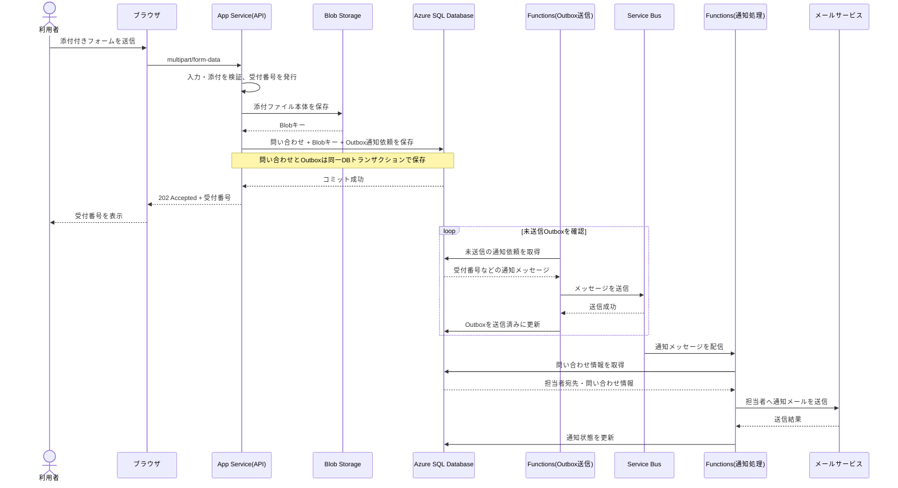

# 回答: 添付付き問い合わせの受付（初級）

- 問題: [QUESTION.md](QUESTION.md)
- 状態: 回答・レビュー済み

## 設問1: 受付から通知までの流れ

### 自分の回答

1. FormDataで送信
2. FrontDoor,WAF(BOTはじく)
2. AppService(`POST ~/api/v1/contact`等)
3. ServiceBusに入れる（成功時レスポンス200、永続層を前に先に返す）
4. Function
5. 回答：Azure SQL DataBase
- 氏名,連絡先、本文,ハッシュ化したファイル名,受付番号、状態、作成日時
6. データ：Blob(ハッシュ化)
7. 完了メール送信

### 振り返り

- `FormData` で送る点、App Service・Service Bus・Functions を使う方向はよい。
- **SQLやBlobに永続化する前にキューへ入れて応答する順序は避ける。** 受付記録や添付が保存される前に受付済みと返すと、後続処理の失敗でデータが残らない可能性がある。
- 受付番号を発行し、本文・添付を永続化してから受付成功を返す。メール通知はその後に非同期で進める。DB保存とキュー登録を確実に両立させるにはTransactional Outboxが候補。
- Functionの役割はService Busのメッセージを受けて担当者へ通知すること。問い合わせの正本はSQLに置く。
- ファイル本体はBlobにそのまま保存する。「ハッシュ化したファイル名」だけをBlobに置くのではない。SQLにはBlobのキー、元のファイル名、サイズ、Content-Typeなどを保存する。ハッシュ値は整合性確認などに必要な場合だけ別途保存する。
- 「完了メール」は設問の担当者向け通知を指すことを明記する。利用者には受付番号をAPIの応答で返す。

#### 改善例

1. ブラウザが `multipart/form-data` でApp Serviceへ送る。
2. App Serviceが入力・添付を検証し、受付番号を発行する。
3. 添付をBlobへ、問い合わせと添付メタデータをSQLへ保存する。
4. 通知依頼をService Busへ登録し、利用者へ受付番号を返す。
5. Service BusをトリガーにFunctionsが担当者へメールを送り、SQLの通知状態を更新する。

※ DB保存とキュー登録の間の障害でも通知依頼を失わないようにするなら、Outboxなどを追加する。

#### 模範解答の構成（Mermaid）

- 利用者への応答は、添付と問い合わせ、およびOutboxの保存が成功した後に返す。メール送信完了は待たず、受付番号を `202 Accepted` で返す。
- Outbox送信Functionは、DBへの受付記録とキュー登録の間で通知依頼が失われるのを防ぐための補助。通知本体のFunctionはService Bus Triggerで動き、失敗時はService Busの再試行とDLQで扱う。
- Outbox送信Function自体はTimer Triggerで定期確認する構成が簡単。より細かな即時性が必要なら、変更通知や別の起動方式も選べる。

## 設問2: 問い合わせと添付ファイルの保存先

### 自分の回答
- RDB：回答データ
- NoSQL：今回の検索だと大変？→使わない
- Blob Storage：容量が大きいデータはDBから参照する形で切り離す

### 振り返り

- RDBを受付記録、Blobをファイル本体にする判断は今回の検索条件とデータの性質に合っている。NoSQLを使わない判断も妥当。
- SQLにはBlobのURLそのものより、ストレージ内のキー（Blob名）を保存する。アクセスURLは必要時に発行できる。
- 比較では、RDBは受付番号・状態・作成日時で検索しやすく整合性も扱いやすい、NoSQLは柔軟な大量データやスケールが必要な場合に候補、Blobは大きなバイナリの保管向き、と整理すると理由が明確になる。

## 設問3: メール通知の非同期処理

### 自分の回答
Functionsでtimer-triggerで定期実行するのが一番よさそう？
状態を見て送るものを決めたいが、CQRSを考えると状態だけNoSQLに置いたほうがよさそう

### 振り返り

- Timer Triggerで定期的にSQLを走査する設計も可能だが、この要件ではService Busを使うので、**Service Bus TriggerのFunction**でメッセージ到着時に処理するのが自然。
- Service Busのメッセージには受付番号（または問い合わせID）を入れ、FunctionがSQLから担当者の宛先や本文を取得する。添付ファイル本体や個人情報をキューに複製しない。
- CQRSは不要。問い合わせ内容と通知状態をSQLに置き、Service Busは処理依頼の受け渡しに使えばよい。まずはSQL内の状態列で十分。

## 設問4: 通知失敗時の扱いと確認方法

### 自分の回答
- 再試行はtimer triggerが状態が変わっていないIDに対してリトライするので大丈夫（だが誤ったメアド書いている場合、DLQ に入れたい？）

### 振り返り

- 一時的な失敗はService Bus / Functions側の再試行に任せ、上限を超えたメッセージはDLQへ移す。DLQの件数を監視し、運用担当者が原因を確認して修正後に再送できるようにする。
- SQLには `通知待ち / 通知済み / 通知失敗` などの状態と、必要に応じて試行回数・最終エラーを記録する。
- 誤ったメールアドレスなど再試行しても直らない恒久エラーは、DLQや失敗状態で確認できるようにする。宛先を修正して再送する運用を決める。
- Functionは同じキューのメッセージを再度受け取る可能性がある。通知済みなら重ねて送らないよう、問い合わせIDと通知状態を使って冪等に処理する。

## 設問5: 二重送信の防止

### 自分の回答
メールアドレスのUNIQUE制約を作る、これで防げます

### 振り返り

- メールアドレスのUNIQUE制約では防げない。同じ利用者が別件の問い合わせを送ることもあるため、メールアドレスは一意にすべきではない。
- 送信フォームごとに冪等キー（UUIDなど）を発行し、再送時も同じキーを使う。SQLでそのキーに一意制約を付け、同じキーの再送には既存の受付番号を返す。
- 連打時のボタン無効化は補助になるが、通信再試行や同時リクエストにも対応できるサーバー側の一意制約が要点。
