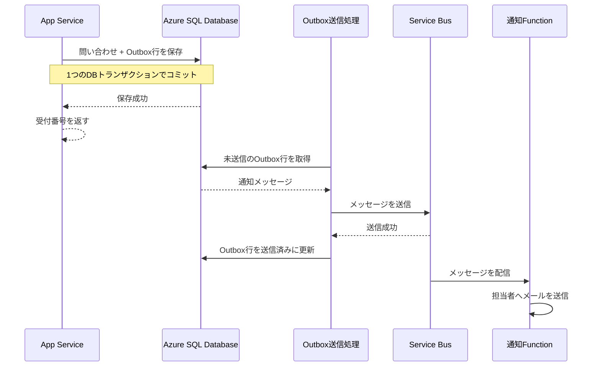

# メモ

## Transactional Outbox
Transactional Outboxは、データベースへの保存と、キューに送る通知依頼の作成を「一緒に確定」する方法です。

DBへの保存とService Busへの送信を別々に行うと、片方だけ成功することがあります。たとえば問い合わせをSQLに保存できた後、Service Busが一時停止すると、受付記録はあるのに通知依頼がキューに届かない状態になります。

そこで、通知メッセージをいったんSQLの Outboxテーブルに保存します。問い合わせ本体とOutboxの行を、同じDBトランザクションでコミットします。

> お問い合わせ番号を発行しないといけないため、キューに入れてあとから処理は不親切だった

