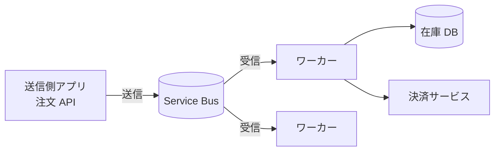
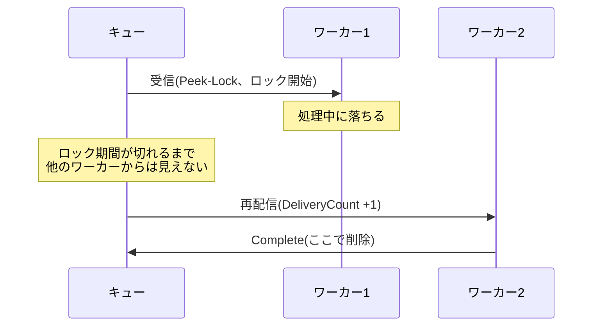

# 01. 注文処理キューの基本設計

## 状況

EC サイトの「注文確定」処理を非同期化したい。

- **送信側アプリ**(注文 API)は、注文を受け付けたらメッセージを送って、すぐに「受付完了」を返す
- **ワーカー**(複数台)はメッセージを受け取り、**在庫 DB** の引き当てと **決済サービス** の呼び出しをする
- 1件の処理は通常 2〜5 秒。セール時は注文数が平常時の約10倍になる
- 1メッセージは注文 ID と明細を含む JSON で、数 KB 程度

運用上、次のことが分かっている。

1. ワーカーは、デプロイやスケールインで処理の途中で落ちることがある
2. まれに、明細が壊れた注文データが混ざる。このメッセージはどのワーカーで何度処理しても例外になる
3. 1件の注文を2回処理すると、二重決済になってしまう

## 問題

1. **キュー** と **トピック/サブスクリプション** のどちらを使いますか? 理由も答えてください
2. 受信モードには **Peek-Lock** と **Receive-and-Delete** があります。どちらを選びますか? 運用上の分かっていること 1(ワーカーが途中で落ちる)が起きたとき、それぞれのモードでメッセージがどうなるかを説明してください
3. 運用上の分かっていること 2(壊れたメッセージ)を放置すると、何が起きますか? Service Bus のどの機能・設定で対処し、その後の運用はどうしますか?
4. 運用上の分かっていること 3(二重決済)について、問題 2 で選んだモードで重複処理は起こりえますか? 起こりうるなら、どこで防ぎますか?
5. (おまけ)この要件なら、Basic / Standard / Premium のどの Tier を選びますか?

## 回答

<!-- ここに回答を書いてください -->

### 問題1

キュー。注文確定処理のみで、優先度などをつける必要がないため。

### 問題2

Peek-Lock を採用。

- ワーカーが落ちうるとき、Receive-and-Delete では復旧が困難
    - 特に、メッセージを受け取っただけで在庫 DB への書き込みすらできずに落ちると、情報が完全に消える。送信側アプリ(注文 API)側で何らかの方法で情報を保持していないと復旧できない
- Peek-Lock なら、ワーカーが落ちてもキューのメッセージはそのまま残る(処理完了による削除が行われない)ので、ロック解放後に別のワーカーが受け取れる

## レビュー

### 問題1

結論(キュー)は正解。ただし理由の軸が少しずれている。

- キューとトピックを分ける本質は **「1つのメッセージを何種類の受信者が受け取るか」**
    - キュー: 1メッセージを **1つの受信者グループのうち1台** が処理する(競合コンシューマー)
    - トピック/サブスクリプション: 1メッセージを **サブスクリプションごとにコピー** し、独立した複数の処理に配る(Pub/Sub)
    - 今回は「注文確定ワーカー」という1種類の処理だけで、ワーカー複数台は同じ処理のスケールアウト → キューでよい
- 「優先度」はキュー/トピック選択の主な理由ではない
    - Service Bus にはネイティブの優先度機能はない。トピックのフィルターで優先度別サブスクリプションに振り分ける実装パターンはある([Priority Queue パターン](https://learn.microsoft.com/azure/architecture/patterns/priority-queue))が、あくまで応用
- 補足(トレードオフ)
    - 将来「注文確定を通知・配送・分析にも配りたい」となったらトピックが必要。キュー → トピックへの変更は送信先エンティティが変わるため送信側の修正が要る
    - そのため「最初からトピック + サブスクリプション1つ」で始める選択肢もあるが、受信者が増える見込みがないならキューでシンプルにするのが妥当
    - Basic Tier はトピック非対応(問題5に関係)

### 問題2

結論(Peek-Lock)も、落ちたときの挙動の説明も正解。以下は補足と、後の問題につながる見落とし。

- 両モードの整理
    - **Receive-and-Delete**: 受信した時点でメッセージは削除済み。受信後に落ちれば消失する(**at-most-once**)
    - **Peek-Lock**: 受信時はロックするだけ。ワーカーが `Complete` して初めて削除される(**at-least-once**)
    - 根拠: [Message transfers, locks, and settlement](https://learn.microsoft.com/azure/service-bus-messaging/message-transfers-locks-settlement)
- 「ロック解放後」の具体的なタイミング
    - ワーカーが異常終了した場合、ロックは **ロック期間(Lock Duration)が切れるまで** 解放されない。既定は 1 分、最大 5 分(エンティティ単位で設定)
    - つまり落ちたワーカーが持っていたメッセージは、最大でロック期間ぶん処理が遅れる。注文確定なら数十秒〜数分の遅延は許容できるか、という観点で設定値を決める
    - デプロイ・スケールインのような **予定された停止** なら、受信を止めて処理中のものを完了させる(グレースフルシャットダウン)か、`Abandon` で即座にロックを返すことで待ち時間をなくせる
- Receive-and-Delete の追加リスク: **プリフェッチ**
    - プリフェッチを有効にすると、クライアントがメッセージを先読みしてメモリにバッファする。Receive-and-Delete だと、バッファにあるだけのまだ処理していないメッセージも、落ちた瞬間に全部消える
    - Peek-Lock でもプリフェッチ分はロックされるが、ロック切れで戻るので消えはしない(ただしバッファ内でロックが切れる問題はある)
    - 根拠: [Prefetch Azure Service Bus messages](https://learn.microsoft.com/azure/service-bus-messaging/service-bus-prefetch)
- 見落とし: **Peek-Lock では重複配信が起こる**(問題4への伏線)
    - 在庫引き当て・決済が終わった後、`Complete` する前に落ちた → ロック切れで別ワーカーが再処理 → 二重決済
    - 処理時間がロック期間を超えた → ロックを失い、まだ処理中なのに別ワーカーにも配られる。今回は 2〜5 秒なので既定 1 分で十分だが、決済サービスが遅延したときに備えて SDK の自動ロック更新(`MaxAutoLockRenewalDuration` など)を使うのが一般的
    - 「消えない」代わりに「2回届くことがある」がトレードオフ
- 再配信されるたびに `DeliveryCount` が増える。これが上限(`MaxDeliveryCount`、既定 10)に達するとデッドレターキューに移る → 問題3につながる
- Receive-and-Delete が向く場面も押さえておくとよい: 多少失われても困らないテレメトリやログなど。Settle の往復がないぶんスループットは高い

## ポイント
